<p align="center">
  
</p>

<h1 align="center">Cholo Puran Dhaka · চলো পুরান ঢাকা</h1>

<p align="center">A walkable 3D guide to Old Dhaka for first-time visitors: 62 places (for now) with real photos, ready-made walking routes<br>and a planner that builds your day around opening hours, what to order and whether it is open now, a card to show your rickshaw driver,<br>a festival calendar, 400 years of history, a real street map that works offline, and practical tips, each with its source.</p>

<p align="center"><b><a href="https://sifatswapnil2022.github.io/cholo-puran-DHAKA/">Open the live site →</a></b><br><sub>Works on desktop, Android and iPhone, and offline once opened. No sign-up, no install.</sub></p>


<div align="center">
  <video src="https://github.com/user-attachments/assets/6822ec8d-0fea-49e7-a6aa-cfe1f780b196" width="480" controls playsinline></video>
</div>


## Why I built it

A lot of people want to visit Old Dhaka, but the practical details are scattered across Facebook posts and old blogs: which day Ahsan Manzil is shut, where the original Nanna Biryani is, whether a car can reach the gate. I live in Gendaria, so these lanes are home ground. I wanted one place that answers those questions on a map you can actually walk through.

Google Maps is still the best way to get from A to B. This is for deciding where to go, and when.

It is also an HCI question I care about: does a 3D street-level view help people find their way in dense, non-grid lanes better than a flat map?

## What it does

- **Walking routes.** Four ready-made days out: *Old Dhaka in one day*, a food crawl, a golden-hour river walk, and a morning of Old Dhaka's many faiths. The route is drawn on the 3D map with numbered stops, suggested times, walking minutes between stops (longer hops marked for a rickshaw), and the days each stop is closed. Every route has its own link, for example [`#route-one-day`](https://sifatswapnil2022.github.io/cholo-puran-DHAKA/#route-one-day).
- **Plan my day.** Three questions (when, what you like, where you start) and the app builds a day that fits: only places that are open when you arrive, nothing on its closed day, mosques skipped during Friday prayers, breakfast, lunch and dinner at the right times, walks and rickshaw hops with fare estimates. Swap any stop, show the day on the map, add it to your calendar, or share it as a link. It runs on the phone, with no account and no server.
- **Photos.** 38 places have a real photo from Wikimedia Commons, picked by hand to make sure it shows the right building, with the photographer and licence under it. Only free licences are used (no NC or ND), and the data check rejects anything else. Places without a free photo yet say so and link to a form to suggest one. `tools/commons.mjs` searches Commons and downloads the picks with their credits.
- **Show the driver.** One tap shows the place name in large Bangla with its area and a well-known landmark nearby, plus "Please take me here" and "How much will the fare be?" in Bangla, each with an English line underneath. The screen stays on while it is open.
- **Street map.** One tap switches from 3D to a real OpenStreetMap street map with every place pinned (clustered when zoomed out), routes drawn street by street, and your own position in Near me. Devices without 3D support open on the street map automatically.
- **Works offline.** After one visit the app, all places, routes and tips are saved on the phone, and the street map keeps the areas you've looked at. An "Offline" badge shows when you're using the saved copy.
- **Celebrations.** Thirteen of Old Dhaka's festivals through the year, from Durga Puja, Kali Puja and Saraswati Puja to Shab-e-Barat, the kasida singers of Ramadan, the Eid procession, Holi in Shankhari Bazar, Hal Khata at Pohela Boishakh, Shakrain, Ashura, Rath Yatra and Janmashtami. Each shows the next date with a countdown, a month-by-month strip, a filter by community, how to be a good guest, *Show on map* for its places, and *Add to calendar*. Pins pulse on the map while a celebration is on, and place cards mention one coming up within 30 days.
- **Festival calendar.** Month-by-month calendars for 2026 and 2027 with every celebration marked (moon-based dates marked ≈). Tap a day to see what's on, open its card or its places on the map, or add the whole year to your phone's calendar in one tap. Link: [`#calendar`](https://sifatswapnil2022.github.io/cholo-puran-DHAKA/#calendar).
- **History of Old Dhaka.** A timeline from before 1608 to 2026 in six periods (Mughal capital, Naib Nazims and the Company, the Nawabs and the Raj, the Pakistan years and 1971, Bangladesh), 59 events, each with its source or a link to the place card that holds it. Each period can be shown on the map. Also as a plain page for search engines: [`history/`](https://sifatswapnil2022.github.io/cholo-puran-DHAKA/history/).
- **Crafts.** Rickshaw painting, conch-shell bangles, kites, bakarkhani and chinitikri mosaic: where to watch and what is worth buying.
- **Say it in Dhakaiya.** A short phrasebook of Old Dhaka's own Bangla (Dhakaiya Kutti), in Bangla script, romanised and next to standard Bangla. Tap to hear it.
- **Listen.** Any place card can be read aloud by the phone's own voice.
- **A page for every place.** Each place has its own page (for example [`place/ahsan-manzil`](https://sifatswapnil2022.github.io/cholo-puran-DHAKA/place/ahsan-manzil/)) with a preview image, so links look good when shared on Facebook or WhatsApp and search engines can find them. There is also [a list of all places](https://sifatswapnil2022.github.io/cholo-puran-DHAKA/place/).
- **Help keep it right.** Every card has *Report a mistake* and *I run this place*; the Places page has *Suggest a place*. They open short GitHub forms. Places that someone has checked in person get a green *Checked on site* badge.
- **Before you go.** Getting there, getting around the lanes, what to wear, money, food and water, staying safe, when to go and dates to know, with a 999 emergency button (press 2 for English). Every section lists its sources.
- **Open now.** Places with published hours show "Open now · until 16:30" or "Closed now · opens tomorrow 9:30", always in Dhaka time, with seasonal hours (Ahsan Manzil, Lalbagh Fort) and 24-hour places handled.
- **Near me.** On a phone in Old Dhaka, one tap lists the ten closest places with walking minutes, whether they are open, and a rickshaw fare estimate. Your location stays on your phone; it is never sent anywhere.
- **What to order.** Food places list their dishes in English and Bangla, with prices where a source gives them and the year of that price.
- **Fare estimates.** Rickshaw hops on the routes and in Near me show an estimate (৳15–20 per km, at least ৳20) and, for longer trips, the official CNG fare.
- **Filters.** Open now, budget, good for families, lesser-known, and has a washroom, on the map and in the list. Search also finds dishes, so typing "nihari" finds the nihari shops.
- **Start here.** First-time visitors get a short welcome with the four routes, Plan my day, the tips and an option to explore the map on their own.
- **3D Old Dhaka.** Orbit, pan and zoom over the old city and the Buriganga. Tap a marker and the camera flies to the place.
- **Walk mode.** Drop to street level in front of any place and walk with W A S D, the arrow keys or an on-screen pad. Walls and the river block you, and nearby places show distance and direction.
- **Place cards.** Why go, history, entry fees, hours and closed days (with a warning if it is closed today), quieter and busiest times, photo tips, vehicle access, seating and washrooms, nearby places, and the sources for every fact.
- **Time of day.** A slider moves the light from dawn to night and suggests places that suit that hour.
- **Places view.** The same 62 places as a plain list that works without 3D, sortable by neighbourhood or by how little known they are.
- **Bangla and English** throughout the interface. Place names are shown in both scripts.
- **Shareable links.** Every place, route and section has its own address, for example [`#ahsan-manzil`](https://sifatswapnil2022.github.io/cholo-puran-DHAKA/#ahsan-manzil) or [`#festivals`](https://sifatswapnil2022.github.io/cholo-puran-DHAKA/#festivals).

| | |
|---|---|
| 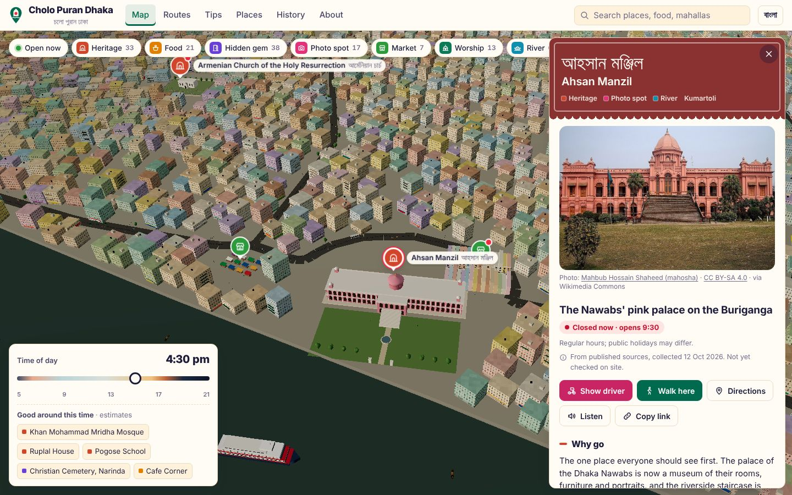 | 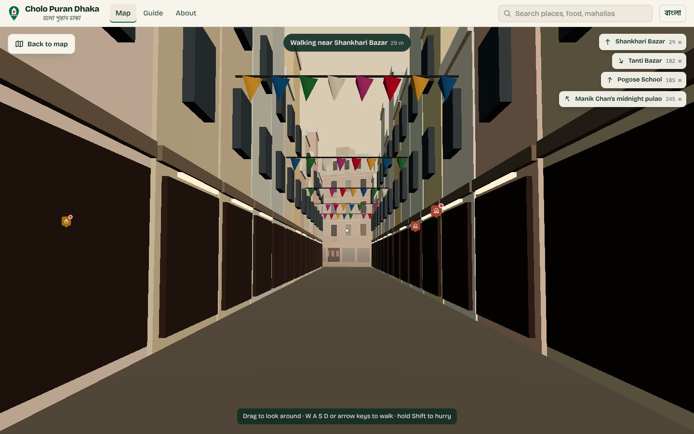 |
| Place card for Ahsan Manzil | Street level in Shankhari Bazar |
| 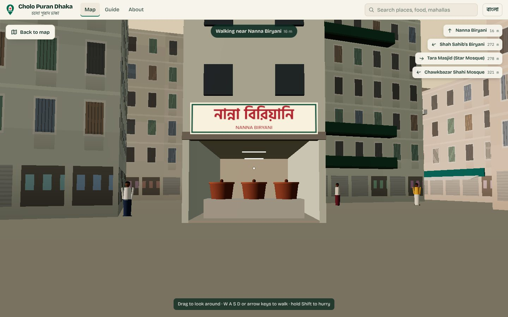 | 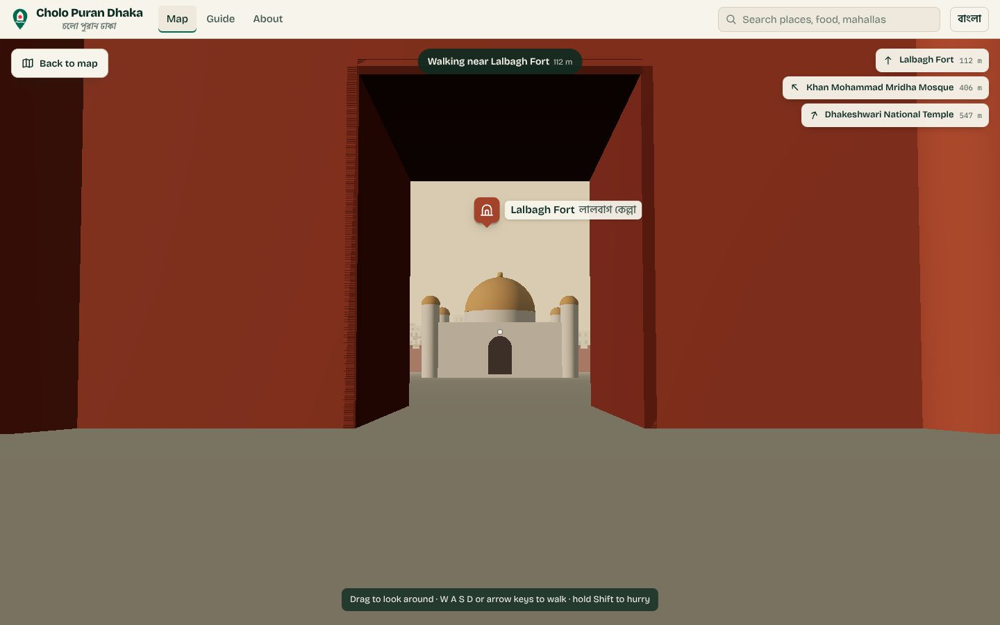 |
| Nanna Biryani in walk mode | Lalbagh Fort through the south gate |
| 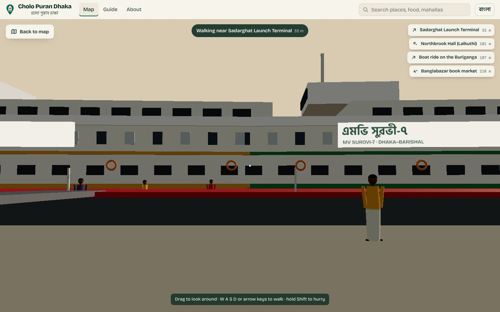 | 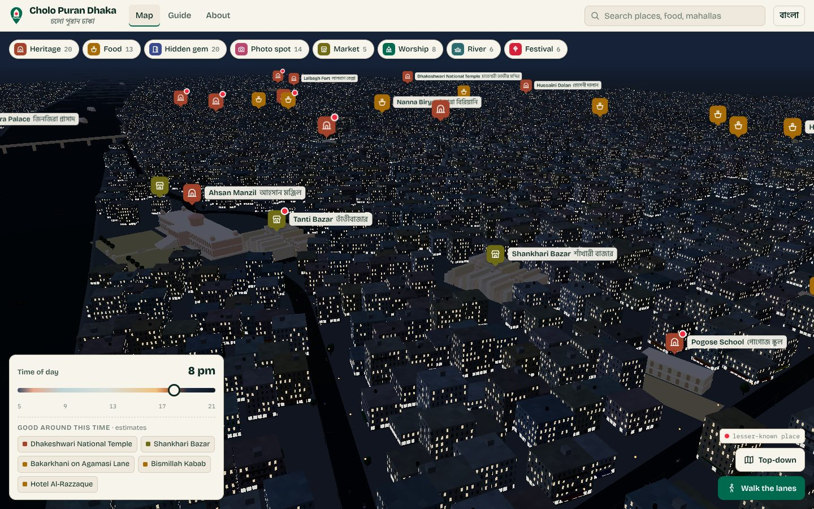 |
| Named launches at Sadarghat | The same streets at night |

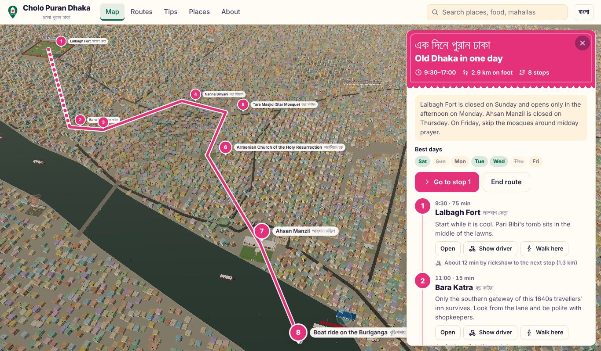

## On phones

The site is built to feel like an app on Android and iPhone:

- **Tab bar.** Map, Routes, Tips, Places, History and About sit at the bottom, within thumb reach.
- **Bottom-sheet place cards.** Drag a card down to shrink it, down again to close it, or up to expand it.
- **Back button.** Android's back button and the iPhone back swipe close the card or leave walk mode instead of leaving the site.
- **Add to Home Screen.** Installs with its own icon, opens full screen and works offline. Long-press the icon on Android for shortcuts: Routes, Near me, Festivals, Tips. See [docs/ANDROID.md](docs/ANDROID.md) for putting it on Google Play.
- **Share.** The place card uses the phone's own share sheet.
- **Fits every screen.** Respects the notch and home bar, has a compact layout for phones held sideways, and stops iOS zooming in when you tap the search box.
- **Lighter on phones.** The app detects low-power devices and uses lighter settings.

<p align="center">
  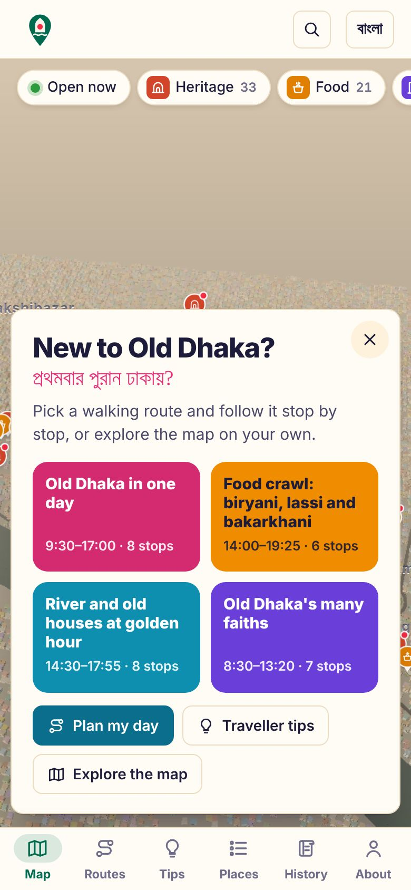
  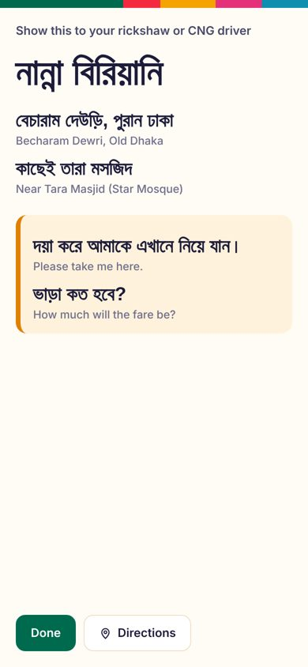
  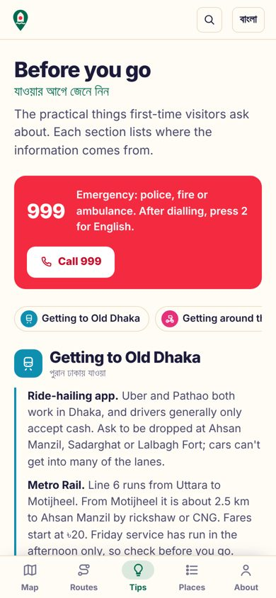
</p>

<p align="center">
  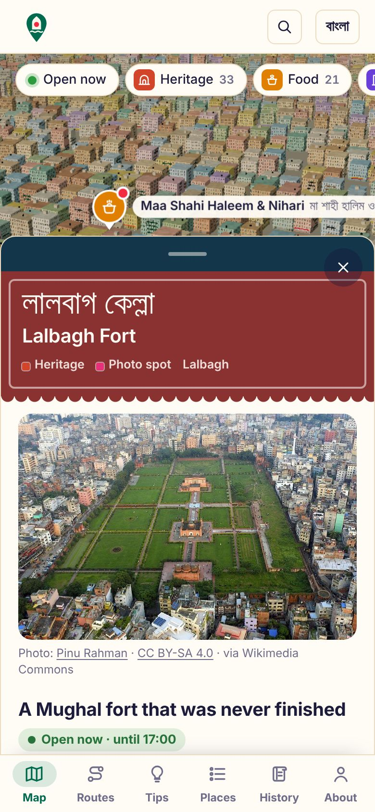
  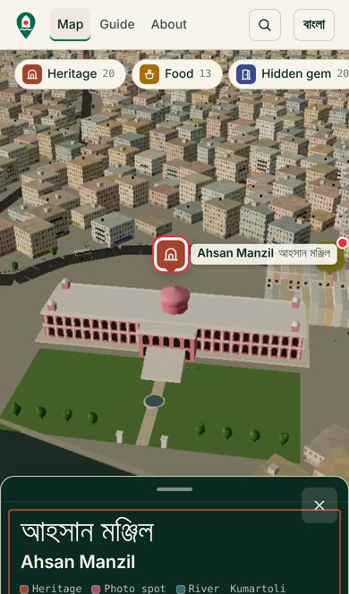
  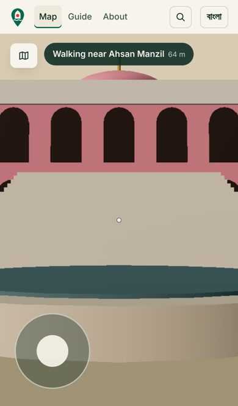
</p>

<p align="center">
  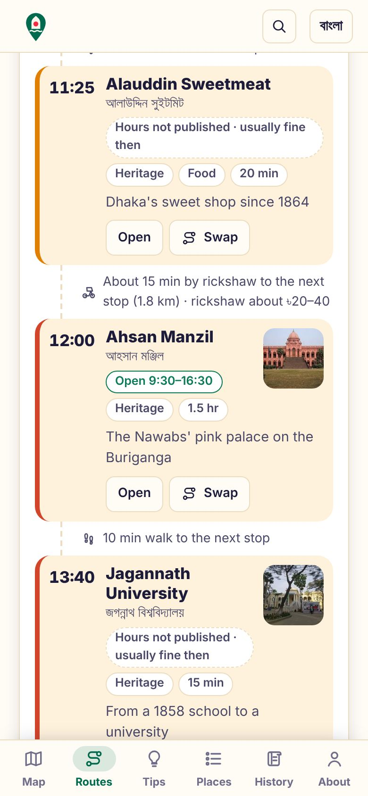
  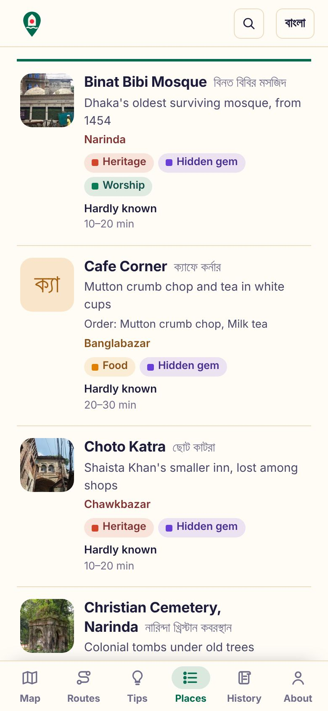
  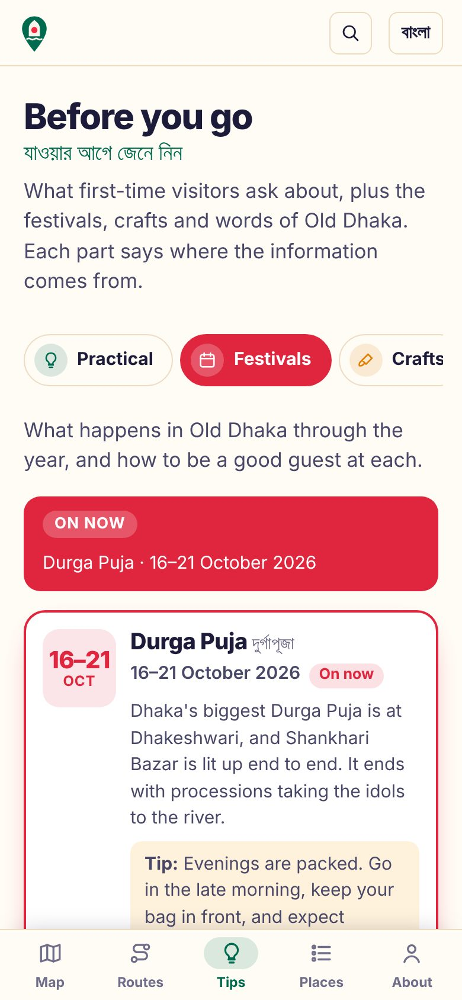
</p>

## Browser support

Tested on phone, tablet and desktop sizes from a 280 px folded Galaxy Fold to 1920 px desktops, in portrait and landscape, in English and Bangla.

- **iPhone and iPad:** iOS 15 and newer. Import maps only arrived in Safari 16.4, so a small shim (`vendor/es-module-shims.js`) loads the app on older iOS; it does nothing on newer browsers.
- **Android:** Chrome 90+ and Samsung Internet 15+. Colours that use `color-mix()` have plain fallbacks for browsers older than Chrome 111 and Safari 16.2.
- **Desktop:** current Chrome, Edge, Firefox and Safari.
- **Without 3D (WebGL):** the street map opens instead.
- **Accessibility:** checked with axe-core; icon-only buttons have spoken names, and tap targets are at least 36–44 px on touch screens.

## The places

Heritage sites (Ahsan Manzil, Lalbagh Fort, Tara Masjid, the Armenian Church, Dhakeshwari Temple, Hussaini Dalan, Bara and Choto Katra, Ruplal House, Northbrook Hall, Jinjira Palace across the river and more), food (Haji Biryani, Nanna Biryani, Beauty Lassi, Nirob Hotel, Bismillah Kabab, Beauty Boarding, bakarkhani on Agamasi Lane and others), markets (Shankhari Bazar, Islampur, Banglabazar, the Chawkbazar iftar market), the river (Sadarghat and a nouka ride on the Buriganga) and festivals (Shakrain).

Added in October 2026: Alauddin Sweetmeat (since 1864), Maa Shahi Haleem & Nihari (breakfast nihari that sells out by eight), Peshwarain, Pannu Khan Tea Store (open 24 hours), Bukhari Restaurant, Medina Mishtanna Bhandar, the Nazira Bazar food street, Kartalab Khan Mosque (1704, with Bengal's only baoli), St Thomas Church (1821), the Nimtali Deuri museum, Haturia House, Sutrapur Zamindar Bari, Mangalabash, Sadhana Aushadhalaya and Simanta Pathagar.

Added later in October 2026: Dhaka Collegiate School, Jagannath University, Chowrangi Restaurant (luchi and dal breakfast), the Bangshal Road rickshaw market, Joy Kali Temple, Ramakrishna Mission and the Swamibagh ISKCON temple.

Lesser-known places are marked with a red dot so visitors can go beyond the usual three. More places are being added in batches.

## How it works

- **No framework, no build step for the app.** Plain HTML, CSS and JavaScript (ES modules) in one `index.html`, with [three.js](https://threejs.org/) r160 from a CDN for the 3D and `places.json` for the data.
- **Street map.** [Leaflet](https://leafletjs.com/) 1.9 and Leaflet.markercluster, kept in `vendor/` and loaded only when you switch to it. Tiles from OpenStreetMap.
- **Offline.** A service worker (`sw.js`) loads pages and `places.json` from the network first and falls back to the saved copy; three.js, icons and fonts come from the saved copy; up to 600 map tiles you have viewed are kept.
- **Place pages.** `tools/build-pages.mjs` (Node, no dependencies) writes `place/<slug>/index.html` with schema.org data (TouristAttraction or Restaurant, coordinates, opening hours), plus `sitemap.xml`. `tools/cards.py` draws the 1200×630 preview images in `docs/og/` and square social cards with Playwright.
- **Real positions.** Every place's latitude and longitude is projected to local metres around Ahsan Manzil, so landmarks sit where they are on the map:

  ```js
  x = (lng − 90.4060583) × 111320 × cos(23.7086°)
  z = −(lat − 23.7085972) × 110574
  ```

- **Landmarks** are modelled in code: Ahsan Manzil's arcades, staircase and lotus dome, Lalbagh Fort's walls, gate and Pari Bibi's tomb, Tara Masjid with a star-mosaic texture, shopfronts with Bangla signboards, and so on.
- **The city around them is generated** for now: about 30,000 houses with painted shutters, iron grilles, balconies, signboards, rooftop water tanks and overhead wires, drawn with instancing and a custom GLSL facade shader. Rickshaws, CNGs, buses, pushcarts, motorbikes, people and boats move along the roads and the river.
- **Plan my day** runs entirely in the browser: it scores each place by your interests, checks its opening hours, closed days, Friday prayer times and festival dates for the chosen day, puts meals at meal times, then builds the order by value per minute of walking and visiting.
- **Flat layers.** The ground, river and roads are drawn first and in a fixed order, and the camera's near plane moves out as you zoom out, so distant surfaces don't flicker into each other.
- **Performance.** Instanced meshes keep draw calls under about 100. The app uses lighter settings on low-power devices and steps down further if the frame rate drops.

## Run it locally

The page loads `places.json` with `fetch`, so it needs a local server rather than opening the file directly:

```bash
git clone https://github.com/SifatSwapnil2022/cholo-puran-DHAKA.git
cd cholo-puran-DHAKA
python3 -m http.server 8000
# open http://localhost:8000
```

## Deploy

It is a static site, live on GitHub Pages at **[sifatswapnil2022.github.io/cholo-puran-DHAKA](https://sifatswapnil2022.github.io/cholo-puran-DHAKA/)** and redeployed on every push to `main` (Settings → Pages → deploy from `main`, root folder).

Any static host works with no build command and the repo root as the publish folder: Netlify or Cloudflare (`wrangler.jsonc` is included). If you move it, change `meta.siteUrl` in `places.json` and run `node tools/build-pages.mjs` so the place pages and sitemap point at the new address.

After editing `places.json`:

```bash
node tools/validate.mjs        # check the data
node tools/build-pages.mjs     # rebuild place pages and sitemap
python3 tools/cards.py og      # redraw preview images (needs Playwright)
```

To have Google index the place pages, add the site in [Google Search Console](https://search.google.com/search-console) and submit `sitemap.xml`. (`robots.txt` only takes effect at a domain root, so it matters once the site has its own domain.)

## Data

`places.json` holds one record per place: bilingual name, categories, coordinates, why go, history, fees, hours, closed days, crowd times, time to spend, who it suits, photography notes, access, and sources. It also holds the walking routes (stops, suggested times and notes), the traveller tips, and the festivals, crafts and phrasebook, all with their sources.

- Facts were collected from published sources on 12 October 2026: Wikipedia, The Daily Star, Dhaka Tribune, The Financial Express, The Business Standard, Daily Observer, Bangladesh Monitor, Nijhoom Tours and food writers. Each place lists its own sources.
- **Nothing has been checked on site yet.** 24 coordinates come from sources; 38 are placed by street or neighbourhood and are marked approximate in the app. [docs/FIELD-CHECK.md](docs/FIELD-CHECK.md) explains how to check a place in person and record it.
- Every change to `places.json` is checked by `tools/validate.mjs` (required fields, coordinates inside Old Dhaka, opening-hours format, dishes, sources, and that routes and tips point at things that exist). GitHub runs it on every push.
- The traveller tips draw on UK FCDO travel advice (updated 9 October 2026), The Business Standard (official CNG fares, February 2025), UNB (999 in English, February 2025), Wikipedia (Metro Line 6), Wikivoyage, Nijhoom Tours and weather data. Each tips section links its sources.
- Route walking times are estimates from straight-line distance (× 1.3 for the lanes, at about 75 m a minute). Legs over about 900 m are suggested by rickshaw.
- Festival dates come from UK FCDO advice and published calendars; lunar dates can move by a day. Craft and phrasebook entries cite UNESCO, The Daily Star and Wikipedia.
- Hours and fees change. If you spot something wrong, use *Report a mistake* on the card or [open an issue](https://github.com/SifatSwapnil2022/cholo-puran-DHAKA/issues/new/choose).

## Roadmap

- [x] Phone support: bottom sheets, back gesture, Add to Home Screen
- [x] Open now, Near me, filters, what to order and fare estimates
- [x] Walking routes, a show-the-driver card and traveller tips
- [x] Real street map, more places (62)
- [x] A page for every place, sitemap, offline mode
- [x] Festivals, crafts, Dhakaiya phrasebook, listen
- [x] Suggest a place, report a mistake, owner updates, checked-on-site badge
- [x] Installable app with shortcuts, Play Store guide, social cards
- [x] Festival calendar, history of the old city, Plan my day
- [x] Real photos from Wikimedia Commons, with credit (38 of 62 places so far)
- [ ] Free photos for the rest, mostly food shops
- [ ] Field-check every card and fix the approximate pins
- [ ] Use OpenStreetMap buildings and lanes in the 3D city
- [ ] Full Bangla descriptions
- [ ] Reviews and visitor photos (needs a small backend)
- [ ] A small user study comparing 3D and 2D maps for wayfinding

## Project structure

```
index.html            the whole app: UI, 3D scene, landmarks, walk mode
places.json           the places, routes, tips and their sources
sw.js                 service worker for offline use
place/                generated page for every place, plus place/index.html (do not edit by hand)
history/              generated plain page of the history timeline
img/                  place photos from Wikimedia Commons (img/t/ holds thumbnails); credits are in places.json
sitemap.xml           generated list of pages for search engines
tools/validate.mjs    checks places.json; runs on every push (.github/workflows/check.yml)
tools/build-pages.mjs writes place/ and sitemap.xml from places.json
tools/commons.mjs     searches Wikimedia Commons and downloads picked photos with credits (run by .github/workflows/photos.yml)
tools/photo-picks.json the Commons file chosen for each place
tools/cards.py        draws link-preview images, social cards and shortcut icons
tools/fonts/          fonts used by tools/cards.py (SIL Open Font License)
vendor/leaflet/       Leaflet and Leaflet.markercluster for the street map
vendor/es-module-shims.js  import-map support for iOS 15–16.3
manifest.webmanifest  app name, colours, icons, shortcuts and screenshots
icons/                home-screen, app and shortcut icons
docs/                 logo, screenshots, preview images (og/), field-check and Android guides
.github/              data checks and the suggest / report / owner-update forms
tools/music.py        generates the original soundtrack used in the demo video
wrangler.jsonc        optional config for Cloudflare deploys
```

## Credits and licence

- Code: MIT, see [LICENSE](LICENSE).
- Photos in `img/`: from [Wikimedia Commons](https://commons.wikimedia.org/), each under its own free licence (CC BY, CC BY-SA, CC0 or public domain), not the licences above. The photographer, licence and a link to the original are shown under every photo and stored in `places.json`. Resized to 960 px; otherwise unchanged.
- Place descriptions and data: [CC BY-NC 4.0](https://creativecommons.org/licenses/by-nc/4.0/). Share with credit; not for resale.
- [three.js](https://threejs.org/) (MIT), [Leaflet](https://leafletjs.com/) and Leaflet.markercluster (BSD-2 / MIT). Map data © [OpenStreetMap](https://www.openstreetmap.org/copyright) contributors. Fonts: Bricolage Grotesque, Hind Siliguri, Galada and IBM Plex Mono (SIL Open Font License). Bangladesh outline: Natural Earth via world-atlas.
- The demo video's music is original: a soft piano piece in D major, synthesized by `tools/music.py`.

## Author

**Md Sifatullah Sheikh**, CSE, East West University · [Portfolio](https://mywebsite-j7mf.onrender.com/#/)
