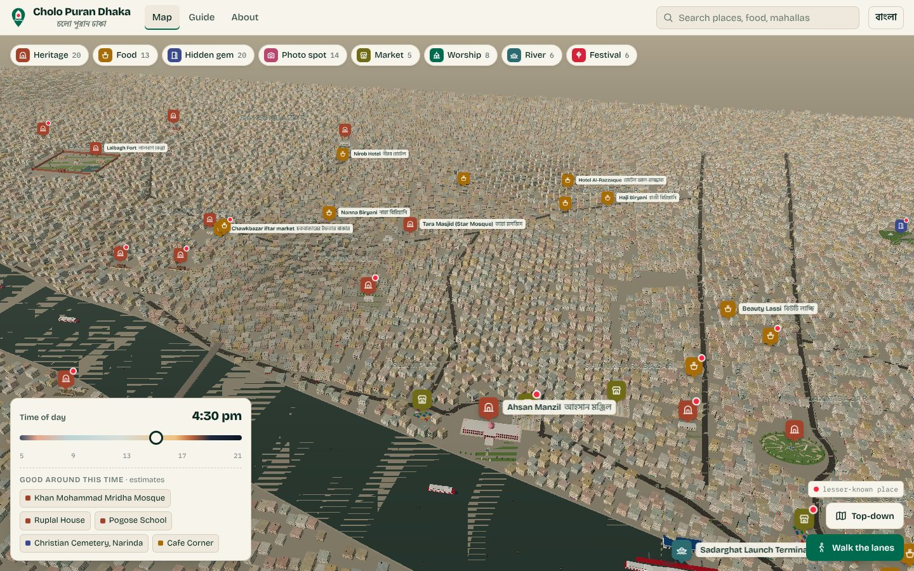

<p align="center">
  
</p>

<h1 align="center">Cholo Puran Dhaka · চলো পুরান ঢাকা</h1>

<p align="center">A walkable 3D guide to Old Dhaka: 40 places, food spots and hidden lanes,<br>each with fees, hours, closed days, the best time to go and how to get there.</p>

<p align="center"></p>

## Why I built it

A lot of people want to visit Old Dhaka, but the practical details are scattered across Facebook posts and old blogs: which day Ahsan Manzil is shut, where the original Nanna Biryani is, whether a car can reach the gate. I live in Gendaria, so these lanes are home ground. I wanted one place that answers those questions on a map you can actually walk through.

It is also an HCI question I care about: does a 3D street-level view help people find their way in dense, non-grid lanes better than a flat map?

## What it does

- **3D Old Dhaka.** Orbit, pan and zoom over the old city and the Buriganga. Tap a marker and the camera flies to the place.
- **Walk mode.** Drop to street level in front of any place and walk with W A S D, the arrow keys or an on-screen pad. Walls and the river block you, and nearby places show distance and direction.
- **Place cards.** Why go, history, entry fees, hours and closed days (with a warning if it is closed today), quieter and busiest times, photo tips, vehicle access, seating and washrooms, nearby places, and the sources for every fact.
- **Time of day.** A slider moves the light from dawn to night and suggests places that suit that hour.
- **Guide view.** The same 40 places as a plain list that works without 3D, sortable by neighbourhood or by how little known they are.
- **Bangla and English** throughout the interface. Place names are shown in both scripts.
- **Shareable links.** Every place has its own address, for example `#ahsan-manzil`.

| | |
|---|---|
|  |  |
| Place card for Ahsan Manzil | Street level in Shankhari Bazar |
|  |  |
| Nanna Biryani in walk mode | Lalbagh Fort through the south gate |
|  |  |
| Named launches at Sadarghat | The same streets at night |

## The 40 places

Heritage sites (Ahsan Manzil, Lalbagh Fort, Tara Masjid, the Armenian Church, Dhakeshwari Temple, Hussaini Dalan, Bara and Choto Katra, Ruplal House, Northbrook Hall, Jinjira Palace across the river and more), food (Haji Biryani, Nanna Biryani, Beauty Lassi, Nirob Hotel, Bismillah Kabab, Beauty Boarding, bakarkhani on Agamasi Lane and others), markets (Shankhari Bazar, Islampur, Banglabazar, the Chawkbazar iftar market), the river (Sadarghat and a nouka ride on the Buriganga) and festivals (Shakrain).

Lesser-known places are marked with a red dot so visitors can go beyond the usual three.

## How it works

- **No build step.** The whole app is one `index.html` using [three.js](https://threejs.org/) r160 from a CDN, plus `places.json` for the data.
- **Real positions.** Every place's latitude and longitude is projected to local metres around Ahsan Manzil, so landmarks sit where they are on the map:

  ```js
  x = (lng − 90.4060583) × 111320 × cos(23.7086°)
  z = −(lat − 23.7085972) × 110574
  ```

- **Landmarks** are modelled in code: Ahsan Manzil's arcades, staircase and lotus dome, Lalbagh Fort's walls, gate and Pari Bibi's tomb, Tara Masjid with a star-mosaic texture, shopfronts with Bangla signboards, and so on.
- **The city around them is generated** for now: about 30,000 houses with painted shutters, iron grilles, balconies, signboards, rooftop water tanks and overhead wires, drawn with instancing and a custom facade shader. Rickshaws, CNGs, buses, pushcarts, motorbikes, people and boats move along the roads and the river.
- **Performance.** Instanced meshes keep draw calls under about 100. The app detects low-power devices, uses lighter settings there, and steps down further if the frame rate drops.

## Run it locally

The page loads `places.json` with `fetch`, so it needs a local server rather than opening the file directly:

```bash
git clone https://github.com/SifatSwapnil2022/cholo-puran-DHAKA.git
cd cholo-puran-DHAKA
python3 -m http.server 8000
# open http://localhost:8000
```

## Deploy

It is a static site. Any static host works: GitHub Pages (Settings → Pages → deploy from `main`, root folder), Netlify or Cloudflare Pages. No configuration is needed.

## Data

`places.json` holds one record per place: bilingual name, categories, coordinates, why go, history, fees, hours, closed days, crowd times, time to spend, who it suits, photography notes, access, and sources.

- Facts were collected from published sources on 12 October 2026: Wikipedia, The Daily Star, Dhaka Tribune, The Financial Express, The Business Standard, Daily Observer, Bangladesh Monitor, Nijhoom Tours and food writers. Each place lists its own sources.
- **Nothing has been checked on site yet.** 17 coordinates come from sources; 23 are placed by street or neighbourhood and are marked approximate in the app.
- Hours and fees change. If you spot something wrong, please open an issue.

## Roadmap

- [ ] Replace the generated streets and houses with real OpenStreetMap data
- [ ] Field-check every card and fix the approximate pins
- [ ] Full Bangla descriptions
- [ ] Walking trails (heritage walk, food crawl, golden-hour photo walk)
- [ ] Offline mode for use in the lanes
- [ ] A small user study comparing 3D and 2D maps for wayfinding

## Project structure

```
index.html            the whole app: UI, 3D scene, landmarks, walk mode
places.json           the 40 places and their sources
docs/                 logo, screenshots, video cover
tools/music.py        generates the original soundtrack used in the demo video
```

## Credits and licence

- Code: MIT, see [LICENSE](LICENSE).
- Place descriptions and data: [CC BY-NC 4.0](https://creativecommons.org/licenses/by-nc/4.0/). Share with credit; not for resale.
- [three.js](https://threejs.org/) (MIT). Fonts: Bricolage Grotesque, Hind Siliguri, Galada and IBM Plex Mono (SIL Open Font License). Bangladesh outline: Natural Earth via world-atlas.
- The demo video's music is original, synthesized in Raag Bhupali by `tools/music.py`.

## Author

**Md Sifatullah Sheikh**, CSE, East West University · [Portfolio](https://mywebsite-j7mf.onrender.com/#/)
